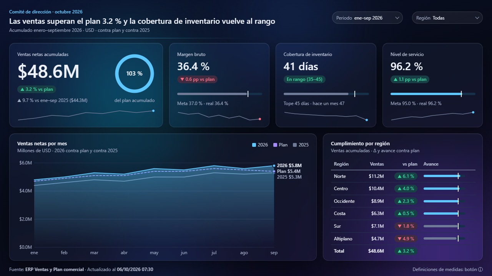
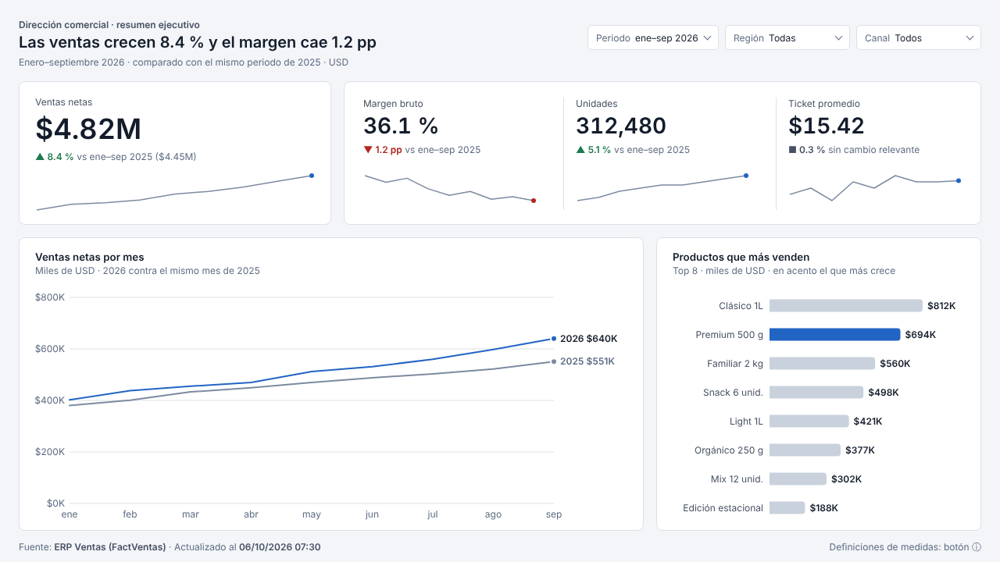

# pbix-toolkit

Autor: **Francisco J. Chacón R.** · Licencia MIT (ver `LICENSE`).

Skill para Claude que **lee, audita, modifica y diseña reportes de Power BI (.pbix)** trabajando solo con metadatos:
nunca abre ni extrae filas de datos. Funciona con archivos de **Power BI Report Server** (Desktop para RS, formato clásico)
y del **servicio de Power BI** (Desktop de la nube, formato PBIR).

| Comité (impactante, 2 capas) | Ejecutivo (sobrio) |
|---|---|
|  |  |

*Diseños de referencia con datos ficticios: la skill los propone en HTML y los replica en Power BI con visuales nativos.*

## Prueba en 2 minutos
El repositorio trae un reporte sintético (`demo/demo_ventas.pbix`) con cinco fallas sembradas a propósito. Con Python 3:

```
python scripts/leer_reporte.py demo/demo_ventas.pbix salida
python scripts/leer_modelo.py demo/demo_ventas.pbix salida --fuente tmdl
python scripts/cruzar_reporte_modelo.py salida salida/modelo_demo_ventas.json salida/cruce
```

El cruce encuentra una medida borrada que sigue en un visual, un mes en texto sin orden, un costo guardado como texto, una
medida sin formato y otra sin uso. O pídeselo a Claude con la skill instalada: «revisa demo/demo_ventas.pbix». El demo solo
trae metadatos y no se abre en Power BI Desktop; `python demo/crear_demo.py` lo vuelve a generar.

## Qué puedes pedirle
| Necesitas… | Ejemplo de pedido |
|---|---|
| Saber qué usa un reporte | «¿Qué tablas, campos y medidas usa este .pbix? ¿Hay referencias rotas?» |
| Documentar o preparar linaje | «Haz el inventario del dashboard de ventas: páginas, visuales, filtros y medidas.» |
| Revisar formatos | «Revisa si hay montos sin formato o fechas largas en los ejes.» |
| Cambiar el reporte | «Mueve los slicers arriba, cambia los títulos y aplica el tema de la empresa.» |
| Crear medidas | «Agrega una medida de variación contra el año anterior con formato %.» → queda lista dentro del archivo |
| Rediseñar o crear un dashboard | «Rediseña el reporte de inventario para el comité.» → pregunta alcance, tipo y público; diseña en HTML y lo replica |
| Un dashboard llamativo | «Hazlo impactante para la junta.» → pregunta el nivel (sobrio / realzado / impactante) y propone diseños innovadores para ese público: fondo con luces y paneles vidrio, medidas SVG, Deneb, sin perder los datos |
| Un diseño propio, no el de siempre | «Quiero algo distinto, inspirado en…» → busca referencias externas, arma un estilo a la medida (colores, tipografía y forma con contraste y daltonismo calculados), elige una estructura de página por la decisión y comprueba que no repite diseños anteriores |
| Saber si sirve para Report Server | «¿Puedo publicar este archivo en nuestro Report Server?» |

Más ejemplos con el flujo que sigue cada uno: `EXAMPLES.md`.

## Cómo trabaja
1. **Lee el archivo** (inventario, reporte, modelo, cruce) y detecta la plataforma: Report Server o servicio, release y formato.
2. **Pregunta lo necesario en una sola ronda** (alcance, tipo de reporte, público, nivel de impacto, formato regional —por defecto el de cada lector—, plataforma; recursos de marca solo si quieres agregarlos) y declara
   como supuesto lo que no respondas; no se detiene a pedir aprobaciones intermedias.
3. **Diseña en HTML** con cifras ficticias (si es rediseño o desde cero) y lo **replica con visuales nativos**. Cada reporte
   lleva una idea propia: inspiración externa traducida a lo que Power BI puede hacer, un estilo a la medida y una estructura
   elegida por la decisión; un registro de diseños evita repetir lo ya entregado. En nivel
   impactante trabaja en dos capas: la decoración (luces, degradados, paneles vidrio) se vuelve la imagen de fondo de la página
   y los visuales reales van encima, transparentes; si luego mueves un visual, se regenera la imagen.
4. **Deja las medidas y formatos listos para ejecutar** dentro del .pbix: abres la vista TMDL, pulsas *Aplicar* y guardas.
5. **Verifica** antes de entregar (estructura, campos, plataforma, catálogo de visuales) y escribe siempre un archivo nuevo.

## Requisitos
| Para | Necesitas |
|---|---|
| Leer el reporte y editarlo | Python 3 (cualquier sistema) |
| Leer el modelo (DAX, M, formatos) | **o** `pip install pbixray` (Windows, o un entorno con `pypi.org` y `files.pythonhosted.org` permitidos) **o** nada: arrastrar «Modelo semántico» a la vista TMDL y guardar (la skill lee ese texto) |
| Revisar los diseños HTML | Node con `playwright` (o Edge instalado) |
| Validación opcional con la herramienta de Microsoft | Node 20+ y `npm install -g @microsoft/powerbi-report-authoring-cli` |
| Aplicar medidas y formatos | Power BI Desktop (de la nube o para Report Server, el mismo con el que se publica) |
| Visuales firma con Deneb (opcional) | Visual Deneb (AppSource; en Report Server, importado desde archivo) |
| Otros visuales de AppSource (opcional) | Certificados, sin licencia y sin Internet; en Report Server, importados desde archivo |
| Inspiración externa (opcional) | Búsqueda web; sin red, la skill usa su catálogo de ideas |

## Instalación
- **claude.ai**: descarga `pbix-toolkit.skill` de la sección **Releases** de este repositorio y súbelo en Customize → Skills →
  + → Upload a skill (es un .zip).
- **Claude Code**: copia la carpeta `pbix-toolkit/` a `~/.claude/skills/` (o a `.claude/skills/` del proyecto), o instálala
  como plugin desde este repositorio, que también es un marketplace:
  ```
  /plugin marketplace add franking04/pbix-toolkit
  /plugin install pbix-toolkit@pbix-toolkit
  ```

## Autor y licencia
Creada y mantenida por **Francisco J. Chacón R.**, con licencia MIT (`LICENSE`): puedes usarla, modificarla y
compartirla conservando el aviso de autoría. Mejoras y errores: abre un issue en el repositorio.
Fuentes, software y referencias en los que se apoya: `RECONOCIMIENTOS.md`.

## Límites
No crea tablas ni cambia Power Query; las medidas y formatos los aplica el usuario con un clic. No lee datos. En Report Server
no hay funciones en preview ni algunas del servicio (ver `references/report_server.md`). Lo marcado **[por validar]** en la
documentación aún no se ha comprobado en pantalla.
